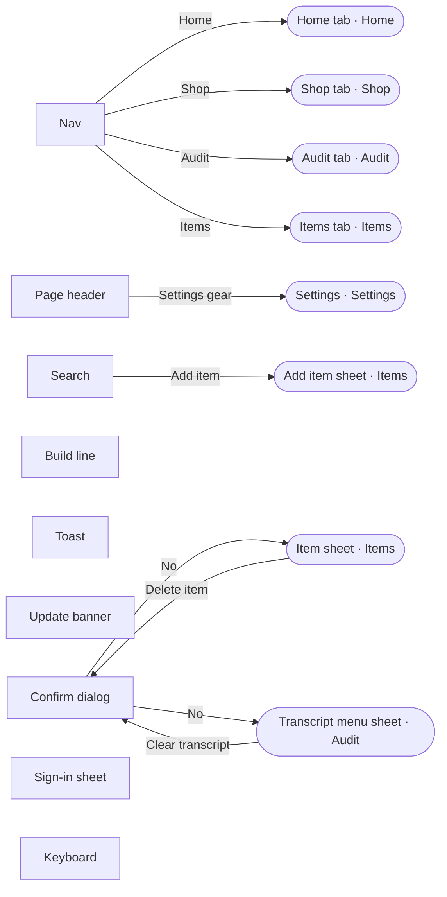
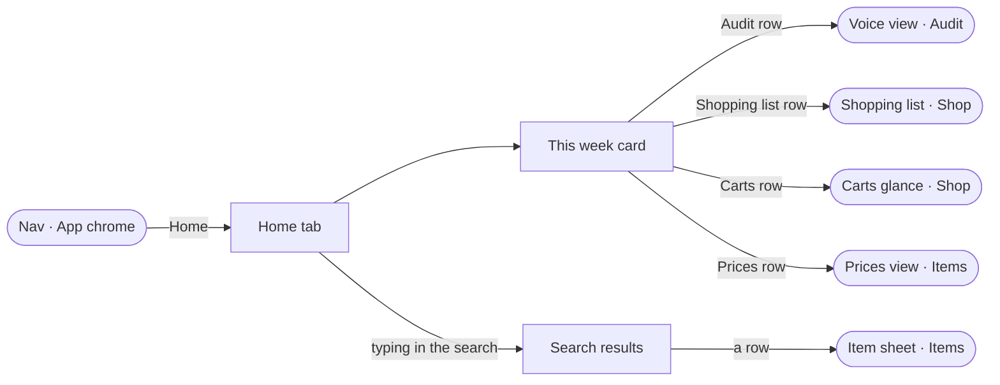
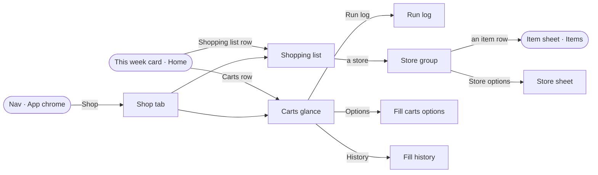
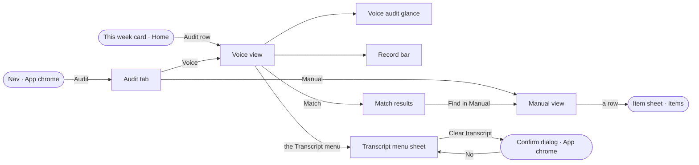
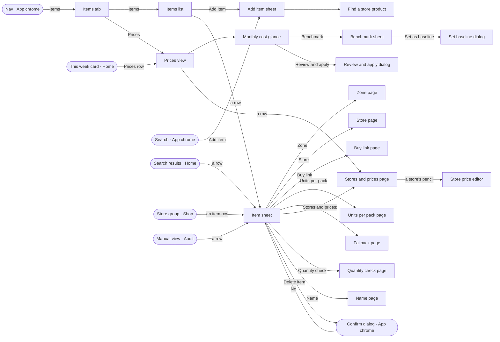
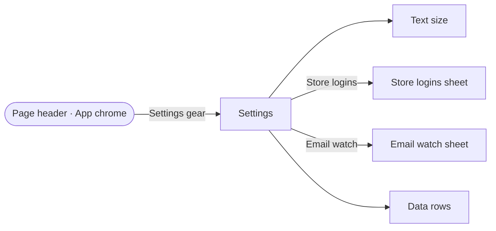

<!-- Generated from docs/ux-surfaces.yaml by scripts/ux_surface_map.py. Do not edit: change the map and re-run. -->

# UX surface map: grocery-shopping-automation

Every surface a person can reach in this app, each under a stable id that its root element carries as `data-surface`. Each area has a diagram of how its surfaces connect; a rounded node is a surface in another area.

The checklist of everything a person can see and do in the grocery PWA served on `:8502`: every tab, view, sheet, dialog, Settings row and state, with how it is reached, what is on it and the decision behind it where one exists. [The PWA at a glance](pwa-overview.md) tells the story in prose; this page is the exhaustive index, so a layout change can check every surface and not only the ones a reviewer happens to open. The legacy Streamlit app on `:8501` drives the same data but is not part of this map.

**Keeping it true.** A change that adds, removes, renames or reshapes a user-visible surface (a tab, view, sheet, dialog, Settings row or state) updates its entry in `docs/ux-surfaces.yaml` in the same change, with the entry's *why* when the choice was deliberate, and regenerates this page with `python scripts/ux_surface_map.py`; this page is never edited by hand. The rule is in `CLAUDE.md`.

**Ids.** `<area>.<surface>`, lowercase words joined by `.` or `-`, the same form the e2e `surface(page, "<id>")` hook takes. An id never changes when a title is reworded or entries are reordered. The surface's root element carries the same id as `data-surface`; the sheets are native `<dialog>`s built by `dialogShell` (`modules/stores/dialog.js`), so each sheet's module stamps its own id in the shell's init callback. `scripts/ux_surface_ratchet.py` fails a surface root without an id, an id without an entry, an entry no element carries, an id on two roots, a link to an id with no entry and a page that is not what the map generates. It reads markup and JS, so the entries marked `none` and every view or state with no root of its own are held by this map and the e2e walk alone.

## Ground rules

**Four tabs, one gear.** The nav is Home · Shop · Audit · Items. Settings is the gear in every page header, not a tab: it opens over whichever tab is showing, and the gear again (or any tab) leaves it. Audit and Items each hold two peer views behind a segmented control (Voice or Manual, Items or Prices); the last view per tab is remembered on the device.

**Layout bands** (the same markup, three placements):

| Band | Condition | Nav |
| --- | --- | --- |
| Phone | touch pointer, up to 520px | floating bottom pill, hidden while a sheet is open |
| Mid window | a mouse up to 520px, or a touch device wider than 520px | inline tab bar pinned at the top |
| Wide | 1100px and up with a mouse | left icon-over-label rail |

**Sheets.** Every sheet and dialog is a native `<dialog>` on the vendored modal shell: a title, a close ×, a body and one full-width primary. Esc and × close it and discard what was staged; a sheet whose changes save as they happen closes on **Done**. Sheets live at `<body>` level, outside the panes, so a pane re-render never tears one down. The nav hides while one is open.

**Where state lives.** The tab, the Audit and Items view, the text size, the theme and the Prices filters are remembered per device in `localStorage`; the shopping progress (Got-it marks, quick-adds, cart offsets) is client-side too. The spreadsheet holds the items; the server holds the fill records and the email-watch settings.

**Gating.** Nothing is switched off by a feature flag. What varies is reachability: Voice needs the voice recorder, the matching service and speech-to-text (each unreachable service is named in the Voice glance), the carts fill needs a store login, and off the install's own PC the API sits behind a password sheet.

Walked 2026-11-17 against build `9fe6d60`, at widths 390, 1280, themes light, dark.

## Areas

| Area | Surfaces |
|---|---|
| [App chrome](#app-chrome) | 9 |
| [Home](#home) | 3 |
| [Shop](#shop) | 8 |
| [Audit](#audit) | 7 |
| [Items](#items) | 19 |
| [Settings](#settings) | 5 |

## App chrome

What every tab shares: the nav, the page header, the search, the confirm dialog, the toast, the update banner, the sign-in sheet and the build line.

### `app.nav` Nav

- **Root:** `data-surface`
- **Reach:**
  - always on screen
  - Arrow keys, Home and End move between the tabs
- **Holds:**
  - four tabs with a glyph and a label, the active one tinted
  - a badge on Shop counting the last fill's misses until Shop has been seen
- **Does:** switches the tab and restores that tab's last view
- **Phone:** a floating bottom pill, hidden while a sheet is open.
- **Desktop:** an inline tab bar at the top, or a left rail from 1100px with a mouse.
- **Why:** the fleet navigation contract caps the bar at four to five destinations, so Settings is the gear, not a tab
- **Leads to:**
  - [Home tab](#hometab-home-tab) (Home)
  - [Shop tab](#shoptab-shop-tab) (Shop)
  - [Audit tab](#audittab-audit-tab) (Audit)
  - [Items tab](#itemstab-items-tab) (Items)

### `app.page-header` Page header

- **Root:** `data-surface`
- **Reach:** the first element of every pane, Settings included
- **Holds:**
  - a glyph and the tab name
  - one live context line that names what needs you, else a plain count
  - the theme toggle and the Settings gear
- **Does:**
  - the toggle flips light and dark and remembers the choice
  - the gear opens Settings over the current tab, and closes it again
- **States:**
  - Home reads the last fill's misses, else when you last audited
  - Shop reads the misses and the items with no buy link, else the count to buy
  - Audit reads the unmatched mentions, else the item count
  - Items reads the items that need checking, else the item count
  - Settings has no context line
- **Why:** each tab opens the same way, and the exception that needs you is named at the top
- **Leads to:** [Settings](#settingsmain-settings) (Settings gear)

### `app.search` Search

- **Root:** `data-surface`
- **Reach:** Home, Manual, the Items list and Prices only
- **Holds:**
  - one search box over item, zone and store
  - the Add item button, on the Items list only
- **Does:**
  - filters the view as you type
  - re-homes under the segmented control of the tab you are on, and inside the Prices list card
- **States:** hidden on Voice, Shop and Settings
- **Why:** one search node moves between views so the segmented control never shifts when the search appears
- **Leads to:** [Add item sheet](#itemsadd-sheet-add-item-sheet) (Add item)

### `app.page-foot` Build line

- **Root:** `data-surface`
- **Reach:** the foot of every tab
- **Holds:** Build, the git sha and the build time of the running server
- **Why:** so you always know which deploy the app is serving

### `app.toast` Toast

- **Root:** none — built inside the vendored toast component, which returns no element to stamp.
- **Reach:** after an action you started
- **Holds:**
  - a brief neutral line above the nav (Saved, Link copied, an item added or deleted)
  - an error line when a request fails
- **Why:** the result of an action is shown, never a dialog

### `app.update-banner` Update banner

- **Root:** `data-surface`
- **Reach:** appears when the server runs a newer build than the page
- **Holds:**
  - the text New version available
  - Reload and a dismiss
- **Does:** Reload is the only thing that reloads the page, so an unsaved draft survives a deploy
- **Why:** a newer build is offered, never forced

### `app.confirm` Confirm dialog

- **Root:** `data-surface`
- **Reach:**
  - Delete item in the item sheet
  - Clear transcript in the Transcript sheet
- **Holds:** a title, one line of consequence, a danger Delete or Clear and a close ×
- **Does:** the confirm button answers yes; × or Esc answers no
- **Why:** an in-app dialog in place of the browser's confirm, which ignores the theme and the type scale
- **Leads to:**
  - [Item sheet](#itemsitem-sheet-item-sheet) (No)
  - [Transcript menu sheet](#audittranscript-menu-transcript-menu-sheet) (No)

### `shared.login` Sign-in sheet

- **Root:** `data-surface`
- **Reach:** any request answered with a 401, off the install's own PC
- **Holds:** the hint Enter the password to use Grocery and one password field
- **Does:** a right password stores the token and retries the request that was refused
- **States:**
  - several refused requests share one sheet
  - a wrong password shows the server's reply
- **Why:** the vendored sign-in component, so every fleet app asks the same way

### `app.keys` Keyboard

- **Root:** none — keyboard paths have no element of their own.
- **Reach:** the keyboard
- **Does:**
  - Arrow keys, Home and End move between the nav tabs
  - Esc closes the open sheet and discards what it staged
  - Enter in the product search box runs the search
  - Tab and Shift+Tab move through rows and controls; Enter on a row opens the item sheet
- **Why:** there is no shortcut layer; the native dialog and the nav own their keys

## Home

The landing tab: a This week card, then a search over every item.

### `home.tab` Home tab

- **Root:** `data-surface`
- **Reach:**
  - nav
  - the first tab on a fresh browser
- **Holds:** the page header, the This week card, the search
- **Why:** Home answers what this week still needs, then lets you look anything up
- **Leads to:**
  - [This week card](#homethis-week-this-week-card)
  - [Search results](#homesearch-results-search-results) (typing in the search)

### `home.this-week` This week card

- **Root:** `data-surface`
- **Reach:** the top of Home
- **Holds:** one row each for Audit, Shopping list, Carts and Prices, each with its current value and a chevron
- **Does:** Audit opens Voice, Shopping list and Carts open Shop, Prices opens Prices
- **States:**
  - values show a dash until the late reads (last audit, last fill, benchmark) arrive, then fill in place
  - a miss in the last fill is tinted danger, an unconfirmed one attention
  - the card is painted once and only its values change, so nothing shifts
- **Why:** one home per fact; a row opens the tab that owns it
- **Leads to:**
  - [Voice view](#auditvoice-voice-view) (Audit row)
  - [Shopping list](#shoplist-shopping-list) (Shopping list row)
  - [Carts glance](#shopcarts-carts-glance) (Carts row)
  - [Prices view](#itemsprices-prices-view) (Prices row)

### `home.search-results` Search results

- **Root:** none — rows rendered into the Home tab's body, which home.tab roots.
- **Reach:** typing in the search on Home
- **Holds:** every item that matches, one row each with zone, store, in stock over target and the buy shortfall
- **Does:** a row opens the item sheet
- **States:**
  - nothing is drawn under the box until something is typed
  - no match shows the empty state No matching items
- **Leads to:** [Item sheet](#itemsitem-sheet-item-sheet) (a row)

## Shop

The carts glance leads, the folded store groups follow.

### `shop.tab` Shop tab

- **Root:** `data-surface`
- **Reach:**
  - nav
  - a This week row
- **Holds:** the page header, the Carts glance, the Shopping list
- **Leads to:**
  - [Carts glance](#shopcarts-carts-glance)
  - [Shopping list](#shoplist-shopping-list)

### `shop.carts` Carts glance

- **Root:** `data-surface`
- **Reach:** the top of Shop
- **Holds:**
  - one row per store with something to buy, its item count and the last fill's outcome chip
  - Fill carts, Stop, Dismiss and Mark purchase done
  - an Options row and a History row
  - the Run log
- **Does:**
  - Fill carts starts a run, or a dry run when Options says so, and shows a live timer
  - Stop ends the run, Dismiss clears a finished run
  - Mark purchase done clears the last fill's red state on every device, and stays in History
- **States:**
  - idle, running with a timer, then a finished run worded by its outcome (verified, missing, unconfirmed, failed, stopped)
  - the outcome chips are Filling, Manual order, N not in cart and N not confirmed
  - Mark purchase done shows only while the last fill has misses and no run is in flight
  - Clean cart without the OK in Options disables Fill carts and says why
  - nothing on the list shows the empty state Nothing on the list to fill
- **Why:** the carts glance answers are the carts filled, and its card is painted once so a Got-it tap never resets the timer
- **Leads to:**
  - [Fill carts options](#shopfill-options-fill-carts-options) (Options)
  - [Fill history](#shopfill-history-fill-history) (History)
  - [Run log](#shoprun-log-run-log) (Run log)

### `shop.run-log` Run log

- **Root:** `data-surface`
- **Reach:** the Run log disclosure at the foot of the Carts glance
- **Holds:** the raw log of the run in flight or the last run
- **States:**
  - idle text Not running when there is no run
  - waiting for output while a run has printed nothing
- **Why:** the log is folded because the summary and the outcome chips carry what matters

### `shop.list` Shopping list

- **Root:** none — store groups rendered into the Shop tab's body, which shop.tab roots.
- **Reach:** below the Carts glance
- **Holds:** one folded group per store with something to buy, plus any store that has quick-adds
- **States:** nothing to buy shows the empty state All stocked up
- **Why:** the household fills the carts and rarely ticks items off after, so the list stays folded and plain
- **Leads to:** [Store group](#shopstore-group-store-group) (a store)

### `shop.store-group` Store group

- **Root:** `data-surface`
- **Reach:** a store's folded card in the Shopping list
- **Holds:**
  - the store name with its done over total items and units
  - one row per item with a Got-it check, the buy figure and a buy link, or a No link chip
  - a quick-add form with a name, a quantity and Add
  - a Store options row
- **Does:**
  - Got-it marks the item bought and strikes it through
  - a row opens the item sheet
  - Add puts a free-text line under the store, with no spreadsheet row behind it
- **States:**
  - folded by default; an open group stays open across a re-render
  - a free-text quick-add row is inert, with its Remove in the store sheet
- **Leads to:**
  - [Item sheet](#itemsitem-sheet-item-sheet) (an item row)
  - [Store sheet](#shopstore-sheet-store-sheet) (Store options)

### `shop.store-sheet` Store sheet

- **Root:** `data-surface`
- **Reach:** the Store options row of a store group
- **Holds:**
  - Already in cart, with an Items and a Units figure
  - Added here, with an Edit toggle, only when the store has quick-adds
  - Unmark all
- **Does:**
  - every change saves as it happens; Done closes
  - Edit reveals a Remove on each quick-add, which removes without a confirm
- **States:** Unmark all is disabled while nothing is marked
- **Why:** Remove is never a visible verb at rest, and removing a quick-add is trivially undone by re-adding it

### `shop.fill-options` Fill carts options

- **Root:** `data-surface`
- **Reach:** the Options row of the Carts glance
- **Holds:**
  - a Store select, a Cart mode select (Keep or Clean) and a Dry run switch
  - a warning and an Yes, empty the cart first switch while Clean is chosen
  - What will run, in words
- **Does:** the store and cart mode are remembered on the device; Dry run and the clean OK are per visit
- **States:** Clean without a dry run needs the OK, or Fill carts stays disabled
- **Why:** a real fill is one tap away, and emptying a store cart is confirmed again every time

### `shop.fill-history` Fill history

- **Root:** `data-surface`
- **Reach:** the History row of the Carts glance
- **Holds:**
  - the last ten fill days, the newest expanded and older ones folded under their date
  - per store the in-cart count, a status chip and its items grouped In cart, Unconfirmed, Would add and Not in cart
- **States:**
  - loading shows Reading the fill history
  - a failed read shows Couldn't load the history with a Retry
  - no fills shows No fills yet
  - a day marked done carries a Done chip

## Audit

Voice leads and opens first; Manual is one tap away.

### `audit.tab` Audit tab

- **Root:** `data-surface`
- **Reach:**
  - nav
  - the Audit row of This week
- **Holds:** the page header, a Voice or Manual segmented control, the view's body
- **Does:** the segmented control switches the view and the choice is remembered
- **Why:** Voice is the weekly path, so it leads and opens first
- **Leads to:**
  - [Voice view](#auditvoice-voice-view) (Voice)
  - [Manual view](#auditmanual-manual-view) (Manual)

### `audit.voice` Voice view

- **Root:** none — cards rendered into the Audit tab's body, which audit.tab roots.
- **Reach:** the Voice segment
- **Holds:**
  - the Voice audit glance, then the match results once there are some
  - the Checklist, one folded zone at a time with a check per kept item
  - the Transcript card with a text area, a Match button and a menu
  - Record pinned at the foot of the pane
- **Does:** the checklist checks are for your eyes only, nothing reads them
- **Why:** the walk is dictated top to bottom, so the Record bar stays under the thumb while the checklist scrolls
- **Leads to:**
  - [Voice audit glance](#auditvoice-glance-voice-audit-glance)
  - [Match results](#auditvoice-results-match-results) (Match)
  - [Record bar](#auditvoice-record-record-bar)
  - [Transcript menu sheet](#audittranscript-menu-transcript-menu-sheet) (the Transcript menu)

### `audit.voice-glance` Voice audit glance

- **Root:** `data-surface`
- **Reach:** the top of the Voice view
- **Holds:**
  - when the last audit ran, with Counts changed and Unmatched from it
  - a banner naming each unreachable service
  - a live waveform and timer while recording
  - Redo transcription and Cancel
  - a status line
- **States:**
  - the banner shows only a problem (the voice recorder, the matching service or speech-to-text down)
  - Redo shows once a take is saved and nothing is recording
  - Cancel shows while a transcription or a match is in flight, with a live elapsed timer
  - a hop to Manual and back keeps a take or a request in flight
- **Why:** only a problem is shown, and a slow local call always shows a timer and a Cancel

### `audit.voice-record` Record bar

- **Root:** `data-surface`
- **Reach:** pinned at the foot of the Voice view
- **Holds:** Record, which becomes Stop recording while a take runs
- **Does:** Stop transcribes the take and then matches it on its own
- **States:**
  - disabled, with the reason as its title, while the voice recorder is unreachable
  - a tint instead of the primary fill once there are match results, where Apply is the one primary
- **Why:** every second is streamed to the PC as it is recorded, so the take survives a dying phone

### `audit.voice-results` Match results

- **Root:** `data-surface`
- **Reach:** appears after Match, or after a take is stopped
- **Holds:**
  - a glance with Counts to apply, Needs you and Apply
  - Needs you first, then the detected items grouped by zone, then Not mentioned
- **Does:**
  - Apply writes the accepted counts to the spreadsheet
  - a detected row has an accept switch showing its change, and Not mentioned has a switch to set the item to zero
  - a Needs you row takes a typed count, and an unmatched mention opens Manual searching for what was heard
- **States:**
  - nothing recognised shows the empty state No recognised items
  - Apply is disabled while nothing is accepted or a request is in flight
  - the choices survive a hop to Manual and back
- **Why:** typing a number is the accept on a count row, so a mention matched wrongly costs nothing
- **Leads to:** [Manual view](#auditmanual-manual-view) (Find in Manual)

### `audit.transcript-menu` Transcript menu sheet

- **Root:** `data-surface`
- **Reach:** the menu button on the Transcript card
- **Holds:**
  - a Match model select
  - Clear transcript
- **Does:** Clear asks first, then wipes the transcript and the match results and keeps the recording on the PC
- **States:** the model select is disabled while a request is in flight
- **Leads to:** [Confirm dialog](#appconfirm-confirm-dialog) (Clear transcript)

### `audit.manual` Manual view

- **Root:** none — zone pills and rows rendered into the Audit tab's body, which audit.tab roots.
- **Reach:**
  - the Manual segment
  - Find in Manual from a Voice mention
- **Holds:**
  - a swipeable line of zone pills, then the zone's kept items (target above 0) in name order
  - one in-stock stepper per row, with the target in its meta line
- **Does:**
  - the stepper changes the in-stock count and saves at once
  - a row opens the item sheet, where the target is edited
- **States:**
  - a search looks in every zone and drops the pills, with the zone leading the meta
  - a phrase as it was said matches by word, so dos yogures de fresa finds yogur fresa
  - an empty zone shows No items in this zone, an empty search shows No matching items
- **Leads to:** [Item sheet](#itemsitem-sheet-item-sheet) (a row)

## Items

The item list, the Add item sheet, the item sheet with its pages, and the Prices view.

### `items.tab` Items tab

- **Root:** `data-surface`
- **Reach:**
  - nav
  - the Prices row of This week
- **Holds:** the page header, an Items or Prices segmented control, the view's body
- **Does:** the segmented control switches the view and the choice is remembered
- **Leads to:**
  - [Items list](#itemslist-items-list) (Items)
  - [Prices view](#itemsprices-prices-view) (Prices)

### `items.list` Items list

- **Root:** none — zone groups rendered into the Items tab's body, which items.tab roots.
- **Reach:** the Items segment
- **Holds:**
  - the search with the Add item button
  - every item grouped by zone in the zones' own order, each group under an overline header, A to Z inside
  - per row the store, in stock over target and the buy shortfall
- **Does:** a row opens the item sheet
- **States:** no items shows No items yet, an empty search No matching items
- **Leads to:**
  - [Add item sheet](#itemsadd-sheet-add-item-sheet) (Add item)
  - [Item sheet](#itemsitem-sheet-item-sheet) (a row)

### `items.add-sheet` Add item sheet

- **Root:** `data-surface`
- **Reach:** the Add item button on the Items list
- **Holds:**
  - the store product search, then an Add by hand form
  - the form has Item, Supermarket, Zone, Target, In stock, Units per pack and URL
- **Does:**
  - the primary adds the row and shows a toast; Esc discards the form
  - Supermarket and Zone are pickers with a New option for a first-time value
- **States:**
  - the form is fresh on every open
  - a failed save keeps the sheet open and shows the server's reason, such as the spreadsheet being open in Excel
- **Why:** the search comes first because a found product fills the form below it
- **Leads to:** [Find a store product](#itemsproduct-search-find-a-store-product)

### `items.product-search` Find a store product

- **Root:** `data-surface`
- **Reach:** the top of the Add item sheet
- **Holds:**
  - a mic, a search box and a search button
  - a status line and Cancel while a search runs
  - one result group per searched term, with a card per candidate showing its thumbnail, name, store and price
- **Does:**
  - Use on a candidate for a new term fills the Add by hand form below
  - Use on a candidate for an item already on the list opens a confirm row with zone, in stock and target
  - Update item saves that row, Add as new item hands off to the form
- **States:**
  - each store reports as it answers, and a store that failed is named with its reason
  - no results shows No results for the term
  - a used candidate reads Added or Updated and is disabled
- **Why:** nothing is picked automatically and nothing is written until you confirm

### `items.item-sheet` Item sheet

- **Root:** `data-surface`
- **Reach:** a tap on any item row, in Home, Shop, Audit, Items and Prices
- **Holds:**
  - the item's name as the title
  - In stock and Target steppers
  - link rows for Zone, Store, Buy link, Units per pack, Fallback if short, Stores and prices, Quantity check and Name, each with its current value
  - Delete item
- **Does:**
  - the item's own cells are staged and Save is the one write; Esc or × discards
  - the two store pages and the fallback page save on their own, at once
  - Delete asks first
- **States:**
  - Save stays disabled until something changed
  - an empty Name, Zone or Store, or a bad Units per pack, opens the page that holds it
  - a store row can open the sheet straight onto Stores and prices
- **Why:** one home for an item's facts, so every row that shows an item opens the same sheet
- **Leads to:**
  - [Zone page](#itemsitem-sheet-zone-zone-page) (Zone)
  - [Store page](#itemsitem-sheet-store-store-page) (Store)
  - [Buy link page](#itemsitem-sheet-link-buy-link-page) (Buy link)
  - [Units per pack page](#itemsitem-sheet-pack-units-per-pack-page) (Units per pack)
  - [Fallback page](#itemsitem-sheet-fallback-fallback-page) (Fallback if short)
  - [Stores and prices page](#itemsitem-sheet-prices-stores-and-prices-page) (Stores and prices)
  - [Quantity check page](#itemsitem-sheet-quantity-quantity-check-page) (Quantity check)
  - [Name page](#itemsitem-sheet-name-name-page) (Name)
  - [Confirm dialog](#appconfirm-confirm-dialog) (Delete item)

### `items.item-sheet-zone` Zone page

- **Root:** `data-surface`
- **Reach:** the Zone row of the item sheet
- **Holds:** a Zone picker with a New zone option
- **Does:** Back returns to the main page

### `items.item-sheet-store` Store page

- **Root:** `data-surface`
- **Reach:** the Store row of the item sheet
- **Holds:** a Store picker with a New store option

### `items.item-sheet-link` Buy link page

- **Root:** `data-surface`
- **Reach:** the Buy link row of the item sheet
- **Holds:**
  - the Buy link field
  - an Open link button
- **States:** a blank cell or a plain search term has nothing to open, so there is no Open link

### `items.item-sheet-pack` Units per pack page

- **Root:** `data-surface`
- **Reach:** the Units per pack row of the item sheet
- **Holds:** one number field and a hint that the cart buys whole packs, rounded up
- **States:** empty means 1

### `items.item-sheet-fallback` Fallback page

- **Root:** `data-surface`
- **Reach:** the Fallback if short row of the item sheet
- **Holds:**
  - a Fallback store select, a Fallback product link field
  - Save fallback, and Clear fallback once one is saved
- **States:**
  - a saved link that is a search page or may not open the product is flagged
  - a store the registry does not list is still offered, so the saved one is never dropped
- **Why:** when the item is short at its store the cart run sends the missing units here

### `items.item-sheet-prices` Stores and prices page

- **Root:** `data-surface`
- **Reach:**
  - the Stores and prices row of the item sheet
  - a Prices row, which opens the sheet straight onto it
- **Holds:**
  - a Checked switch with its date, and the review flags as chips
  - one row per store with the product and link, pack, pack price, price per unit, per month and status
  - a pencil per store, and Link another store
  - Evidence and quality spec, folded
- **Does:** Checked saves at once and clears the stock flag
- **States:**
  - loading shows Reading the item's store details, a failed read shows a Retry
  - no store has the item shows No store has this item yet
- **Leads to:** [Store price editor](#itemsitem-sheet-price-editor-store-price-editor) (a store's pencil)

### `items.item-sheet-price-editor` Store price editor

- **Root:** `data-surface`
- **Reach:** the pencil on a store row of Stores and prices
- **Holds:**
  - the Link at the store
  - for an item in the benchmark basket, your own product name, pack size, unit, pack price and note
- **Does:** Save writes the link and the override, Reset to benchmark drops the override, Cancel closes the form
- **States:** an item outside the benchmark basket can only change its link
- **Why:** blank fields fall back to the benchmark, so an override is only what you typed

### `items.item-sheet-quantity` Quantity check page

- **Root:** `data-surface`
- **Reach:** the Quantity check row of the item sheet
- **Holds:**
  - the old and new pack in real units, and how much you use a month
  - the Target and In stock figures, each with a Use suggested button
- **Does:** Use suggested puts the figure in the sheet's draft, and Save keeps it
- **States:** a note explains why there is no comparison (not in the benchmark basket, units differ, pack size unknown)

### `items.item-sheet-name` Name page

- **Root:** `data-surface`
- **Reach:** the Name row of the item sheet
- **Holds:** the Name field
- **Does:** renaming keeps the row's other cells

### `items.prices` Prices view

- **Root:** none — cards rendered into the Items tab's body, which items.tab roots.
- **Reach:**
  - the Prices segment
  - the Prices row of This week
- **Holds:**
  - the Monthly cost glance
  - an Items card with a count, the search, All and Needs checking and Checked filters, a store filter and two switches (Only items I buy, Show all stores)
  - one row per item with its review chip, a what-if store picker and the store links as pills under it
- **Does:**
  - the what-if picks are local, nothing is written until Review and apply posts them
  - a row opens the item sheet on Stores and prices
- **States:**
  - store data not yet read shows Reading store links, a failed read shows a Retry
  - an empty filter says why, naming the store and Only items I buy when they hid rows
- **Why:** a one-tap link per store is how the list is used, so the pills open each store's product page
- **Leads to:**
  - [Monthly cost glance](#itemsprices-glance-monthly-cost-glance)
  - [Stores and prices page](#itemsitem-sheet-prices-stores-and-prices-page) (a row)

### `items.prices-glance` Monthly cost glance

- **Root:** `data-surface`
- **Reach:** the top of the Prices view
- **Holds:**
  - the what-if total and its saving or cost a month against today
  - a Weekly, 2-weekly or Monthly ordering frequency
  - one action, a Benchmark row
- **Does:** the action is Review and apply once a pick differs from the list, else Load recommended plan
- **States:**
  - no benchmark prices shows No benchmark prices yet
  - pricing shows Pricing your picks, a failed read shows Simulation unavailable with a Retry
  - a failed refresh after a good read keeps the last numbers, labelled with their time
- **Leads to:**
  - [Benchmark sheet](#itemsbenchmark-sheet-benchmark-sheet) (Benchmark)
  - [Review and apply dialog](#itemsapply-dialog-review-and-apply-dialog) (Review and apply)

### `items.benchmark-sheet` Benchmark sheet

- **Root:** `data-surface`
- **Reach:** the Benchmark row of the Monthly cost glance
- **Holds:**
  - Latest run with its date, next review, stores covered and overrides, and how to refresh, folded
  - Plan, with Load recommended plan and Reset to my list
  - Cost breakdown, a what-if against today table, the per-store figures, Set as baseline or Reset to benchmark, and the unpriced items, folded
- **Does:**
  - the primary imports the latest benchmark run
  - Copy steps copies how to refresh the prices
- **States:**
  - no run yet says so and asks for one
  - a review that is due is tinted attention
- **Why:** the benchmark runs in Claude Code because it needs your quality-spec confirmation, never from here
- **Leads to:** [Set baseline dialog](#itemsbaseline-dialog-set-baseline-dialog) (Set as baseline)

### `items.apply-dialog` Review and apply dialog

- **Root:** `data-surface`
- **Reach:** Review and apply on the Monthly cost glance
- **Holds:**
  - one row per store change with the old and new store, product and pack, and an editable Target and In stock
  - warnings when pack units differ or the pack size is unknown
- **Does:** Apply writes every change that has a link; a row with no link is skipped
- **States:**
  - working it out shows a loading state, a failure shows Couldn't prepare the changes
  - nothing to change shows No store changes to apply
  - a Target or In stock that is not a whole number blocks Apply and names the row

### `items.baseline-dialog` Set baseline dialog

- **Root:** `data-surface`
- **Reach:** Set as baseline in the Benchmark sheet
- **Holds:** what freezing the current stores as Today does, and how many items still need checking
- **Does:** Set baseline freezes the current stores as the new Today for the what-if

## Settings

| Group | Row | Value shown | Opens |
| --- | --- | --- | --- |
| Display | **Text size** | Small / Default / Large, in place | no sheet |
| Stores | **Store logins** | Not checked, All logged in or *N logged out* | the Store logins sheet |
| | **Email watch** | Off or the poll cadence | the Email watch sheet |
| Data | **Open spreadsheet** | On the computer | acts on tap |
| | **Copy link** | Tunnel link, Local network link or This page | acts on tap |
| | **Export CSV** | the item count | acts on tap |

### `settings.main` Settings

- **Root:** `data-surface`
- **Reach:** the gear in any page header
- **Holds:** three inset groups, Display, Stores and Data, every row showing its current value
- **Does:** the gear again, or any tab, leaves Settings
- **Why:** Settings is never a tab, so it is one tap from everywhere without taking a nav slot
- **Leads to:**
  - [Text size](#settingstext-size-text-size)
  - [Store logins sheet](#settingsstore-logins-store-logins-sheet) (Store logins)
  - [Email watch sheet](#settingsemail-watch-email-watch-sheet) (Email watch)
  - [Data rows](#settingsdata-data-rows)

### `settings.text-size` Text size

- **Root:** none — an in-place segmented control inside settings.main.
- **Reach:** the Display group of Settings
- **Holds:** Small, Default and Large
- **Does:** applies to every view and is remembered on the device

### `settings.store-logins` Store logins sheet

- **Root:** `data-surface`
- **Reach:** the Store logins row of Settings
- **Holds:**
  - the last check per store with a Logged in, Logged out or Unknown state
  - Check logins and Log in to stores
- **Does:**
  - Check logins opens a Chrome window briefly and touches no cart
  - Log in to stores opens a plain Chrome window on the PC so a stale login can be refreshed
- **States:**
  - never checked shows Not checked on this device yet
  - a store logged out is an attention chip, not a failure of the command
  - a check in flight disables Check logins and keeps its status line
- **Why:** the last result is kept on the device so the row's value survives a reload

### `settings.email-watch` Email watch sheet

- **Root:** `data-surface`
- **Reach:** the Email watch row of Settings
- **Holds:**
  - Senders, one switch per monitored sender with its store
  - Polling, a Poll automatically switch and a Frequency select
  - Check now and Test last email
  - Last checks, the log of recent passes
- **Does:**
  - every change saves as it happens; Done closes
  - Test last email reprocesses the newest confirmation even if it was seen
- **States:**
  - loading shows Loading email watch, a failed read shows Email watch unavailable
  - no senders points at config/gmail_config.sample.json
  - polling off says Automatic polling is off

### `settings.data` Data rows

- **Root:** none — three rows inside settings.main that act on tap and open nothing.
- **Reach:** the Data group of Settings
- **Holds:** Open spreadsheet, Copy link and Export CSV
- **Does:**
  - Open spreadsheet opens the workbook on the computer
  - Copy link copies the tunnel link, the local network link or this page's address
  - Export CSV downloads the items, fetched with the bearer token because a navigation carries none

## Link index

| From | Via | To |
|---|---|---|
| [Nav](#appnav-nav) | Home | [Home tab](#hometab-home-tab) |
| [Nav](#appnav-nav) | Shop | [Shop tab](#shoptab-shop-tab) |
| [Nav](#appnav-nav) | Audit | [Audit tab](#audittab-audit-tab) |
| [Nav](#appnav-nav) | Items | [Items tab](#itemstab-items-tab) |
| [Page header](#apppage-header-page-header) | Settings gear | [Settings](#settingsmain-settings) |
| [Search](#appsearch-search) | Add item | [Add item sheet](#itemsadd-sheet-add-item-sheet) |
| [Confirm dialog](#appconfirm-confirm-dialog) | No | [Item sheet](#itemsitem-sheet-item-sheet) |
| [Confirm dialog](#appconfirm-confirm-dialog) | No | [Transcript menu sheet](#audittranscript-menu-transcript-menu-sheet) |
| [Home tab](#hometab-home-tab) |  | [This week card](#homethis-week-this-week-card) |
| [Home tab](#hometab-home-tab) | typing in the search | [Search results](#homesearch-results-search-results) |
| [This week card](#homethis-week-this-week-card) | Audit row | [Voice view](#auditvoice-voice-view) |
| [This week card](#homethis-week-this-week-card) | Shopping list row | [Shopping list](#shoplist-shopping-list) |
| [This week card](#homethis-week-this-week-card) | Carts row | [Carts glance](#shopcarts-carts-glance) |
| [This week card](#homethis-week-this-week-card) | Prices row | [Prices view](#itemsprices-prices-view) |
| [Search results](#homesearch-results-search-results) | a row | [Item sheet](#itemsitem-sheet-item-sheet) |
| [Shop tab](#shoptab-shop-tab) |  | [Carts glance](#shopcarts-carts-glance) |
| [Shop tab](#shoptab-shop-tab) |  | [Shopping list](#shoplist-shopping-list) |
| [Carts glance](#shopcarts-carts-glance) | Options | [Fill carts options](#shopfill-options-fill-carts-options) |
| [Carts glance](#shopcarts-carts-glance) | History | [Fill history](#shopfill-history-fill-history) |
| [Carts glance](#shopcarts-carts-glance) | Run log | [Run log](#shoprun-log-run-log) |
| [Shopping list](#shoplist-shopping-list) | a store | [Store group](#shopstore-group-store-group) |
| [Store group](#shopstore-group-store-group) | an item row | [Item sheet](#itemsitem-sheet-item-sheet) |
| [Store group](#shopstore-group-store-group) | Store options | [Store sheet](#shopstore-sheet-store-sheet) |
| [Audit tab](#audittab-audit-tab) | Voice | [Voice view](#auditvoice-voice-view) |
| [Audit tab](#audittab-audit-tab) | Manual | [Manual view](#auditmanual-manual-view) |
| [Voice view](#auditvoice-voice-view) |  | [Voice audit glance](#auditvoice-glance-voice-audit-glance) |
| [Voice view](#auditvoice-voice-view) | Match | [Match results](#auditvoice-results-match-results) |
| [Voice view](#auditvoice-voice-view) |  | [Record bar](#auditvoice-record-record-bar) |
| [Voice view](#auditvoice-voice-view) | the Transcript menu | [Transcript menu sheet](#audittranscript-menu-transcript-menu-sheet) |
| [Match results](#auditvoice-results-match-results) | Find in Manual | [Manual view](#auditmanual-manual-view) |
| [Transcript menu sheet](#audittranscript-menu-transcript-menu-sheet) | Clear transcript | [Confirm dialog](#appconfirm-confirm-dialog) |
| [Manual view](#auditmanual-manual-view) | a row | [Item sheet](#itemsitem-sheet-item-sheet) |
| [Items tab](#itemstab-items-tab) | Items | [Items list](#itemslist-items-list) |
| [Items tab](#itemstab-items-tab) | Prices | [Prices view](#itemsprices-prices-view) |
| [Items list](#itemslist-items-list) | Add item | [Add item sheet](#itemsadd-sheet-add-item-sheet) |
| [Items list](#itemslist-items-list) | a row | [Item sheet](#itemsitem-sheet-item-sheet) |
| [Add item sheet](#itemsadd-sheet-add-item-sheet) |  | [Find a store product](#itemsproduct-search-find-a-store-product) |
| [Item sheet](#itemsitem-sheet-item-sheet) | Zone | [Zone page](#itemsitem-sheet-zone-zone-page) |
| [Item sheet](#itemsitem-sheet-item-sheet) | Store | [Store page](#itemsitem-sheet-store-store-page) |
| [Item sheet](#itemsitem-sheet-item-sheet) | Buy link | [Buy link page](#itemsitem-sheet-link-buy-link-page) |
| [Item sheet](#itemsitem-sheet-item-sheet) | Units per pack | [Units per pack page](#itemsitem-sheet-pack-units-per-pack-page) |
| [Item sheet](#itemsitem-sheet-item-sheet) | Fallback if short | [Fallback page](#itemsitem-sheet-fallback-fallback-page) |
| [Item sheet](#itemsitem-sheet-item-sheet) | Stores and prices | [Stores and prices page](#itemsitem-sheet-prices-stores-and-prices-page) |
| [Item sheet](#itemsitem-sheet-item-sheet) | Quantity check | [Quantity check page](#itemsitem-sheet-quantity-quantity-check-page) |
| [Item sheet](#itemsitem-sheet-item-sheet) | Name | [Name page](#itemsitem-sheet-name-name-page) |
| [Item sheet](#itemsitem-sheet-item-sheet) | Delete item | [Confirm dialog](#appconfirm-confirm-dialog) |
| [Stores and prices page](#itemsitem-sheet-prices-stores-and-prices-page) | a store's pencil | [Store price editor](#itemsitem-sheet-price-editor-store-price-editor) |
| [Prices view](#itemsprices-prices-view) |  | [Monthly cost glance](#itemsprices-glance-monthly-cost-glance) |
| [Prices view](#itemsprices-prices-view) | a row | [Stores and prices page](#itemsitem-sheet-prices-stores-and-prices-page) |
| [Monthly cost glance](#itemsprices-glance-monthly-cost-glance) | Benchmark | [Benchmark sheet](#itemsbenchmark-sheet-benchmark-sheet) |
| [Monthly cost glance](#itemsprices-glance-monthly-cost-glance) | Review and apply | [Review and apply dialog](#itemsapply-dialog-review-and-apply-dialog) |
| [Benchmark sheet](#itemsbenchmark-sheet-benchmark-sheet) | Set as baseline | [Set baseline dialog](#itemsbaseline-dialog-set-baseline-dialog) |
| [Settings](#settingsmain-settings) |  | [Text size](#settingstext-size-text-size) |
| [Settings](#settingsmain-settings) | Store logins | [Store logins sheet](#settingsstore-logins-store-logins-sheet) |
| [Settings](#settingsmain-settings) | Email watch | [Email watch sheet](#settingsemail-watch-email-watch-sheet) |
| [Settings](#settingsmain-settings) |  | [Data rows](#settingsdata-data-rows) |
